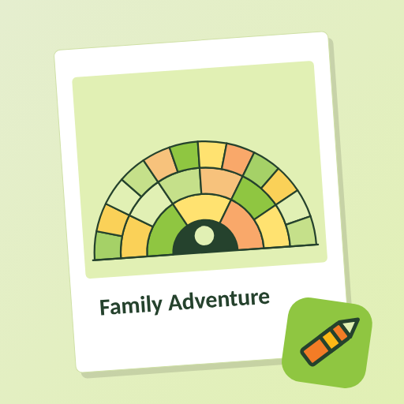

# Family Adventure

A coloring and activity workbook generator that turns a child's family story into printable pages and on-screen coloring. Built for WikiTree families, and it also works with names typed by hand.

- **WikiTree import:** enter a WikiTree ID (the child's, or a parent's) to pull public ancestors. Importing only works when the app is served from `apps.wikitree.com`, because WikiTree's API allows browser requests only from its own app sites.
- **Any family shape:** add any number of parents and guardians in any roles, then add their parents, and so on. No gender fields.
- **Age ranges:** 3–5, 6–8, 9–12 and 13+. The age range sets how many generations are shown and how detailed the drawings are.
- **Pages:** a fan chart with traceable single-line dashed names, an alphabet tracing sheet (younger ages), a "Meet my family" page, a journey page, interview notes, a timeline and a certificate.
- **Privacy:** everything stays in the browser (localStorage). Nothing is sent anywhere except the WikiTree API request when you use Import.

It is a single static file, `index.html`, with no build step. Open it in a browser.

Known limits: Latin letters only for the tracing font (accents are dropped); the journey page is a path of places, not a map.
